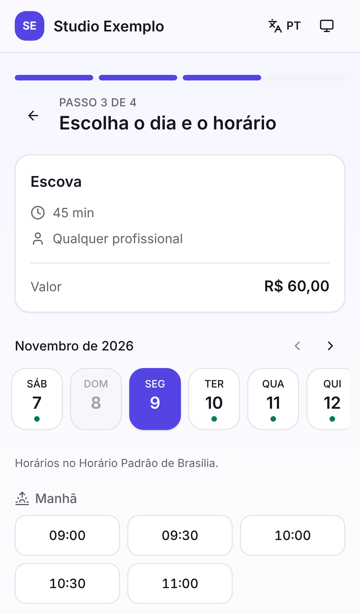
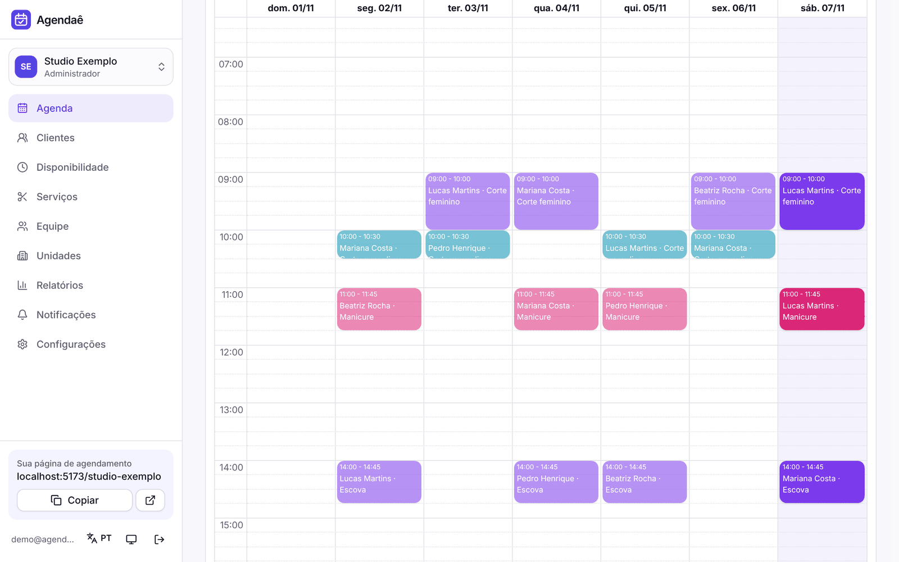
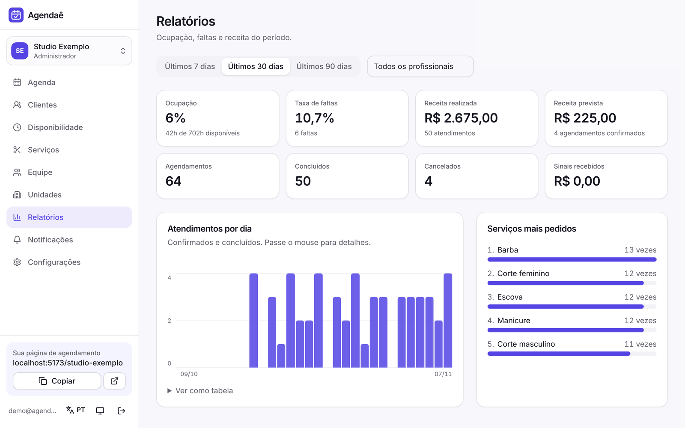
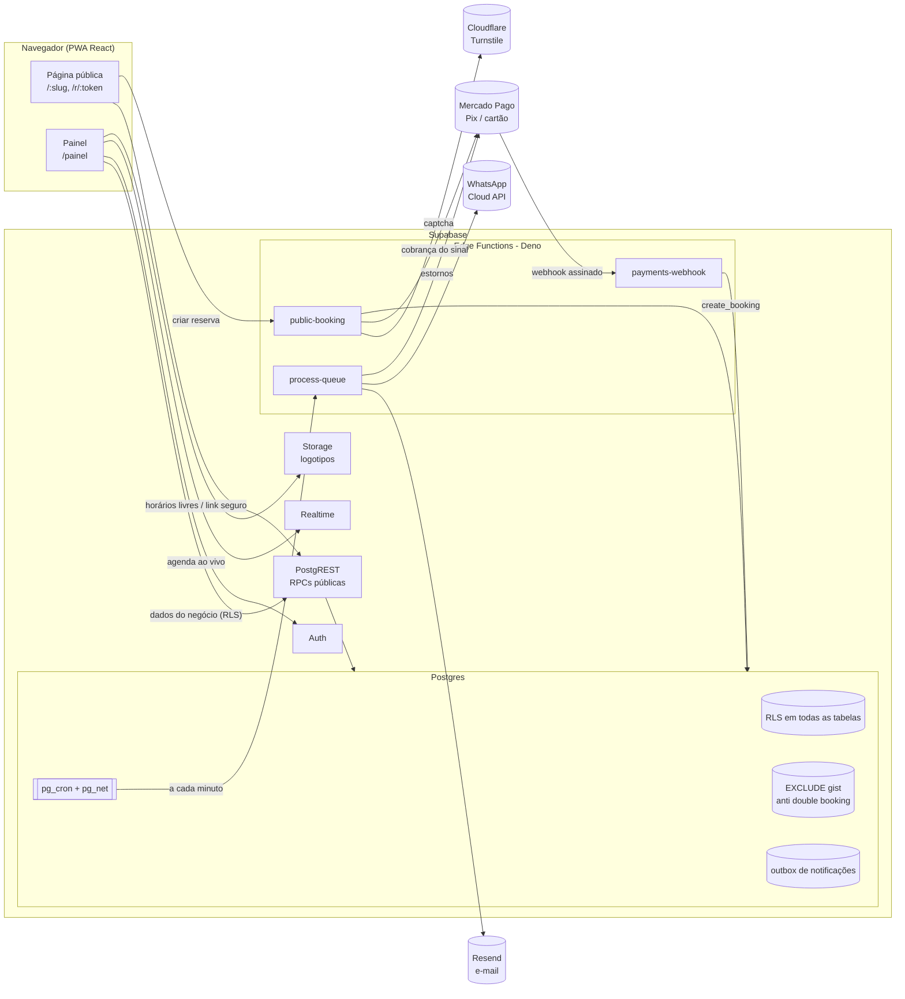
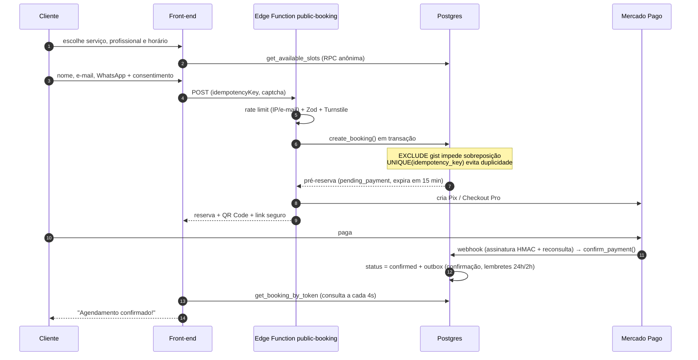

# Agendaê: plataforma de agendamento online

Agendamento online para negócios de serviço com hora marcada (salões, barbearias, estética, clínicas e estúdios). O cliente marca **em até 4 toques pelo celular, sem criar conta**. O negócio recebe **sinal via Pix ou cartão**, envia **lembretes por e-mail e WhatsApp** e **nunca tem dois clientes no mesmo horário**: a garantia está no banco de dados.

> O nome "Agendaê" é provisório e configurável (`VITE_APP_NAME` / `APP_NAME`).
> Pesquisa de mercado: [`docs/PESQUISA.md`](docs/PESQUISA.md) · Escopo MVP/V2/V3: [`docs/ESCOPO.md`](docs/ESCOPO.md) · Banco: [`docs/BANCO.md`](docs/BANCO.md)

| Página pública (celular)                    | Escolha de horário                          | Confirmação                                     |
| ------------------------------------------- | ------------------------------------------- | ----------------------------------------------- |
|  |  |  |

| Agenda do painel (arrastar e soltar)  | Relatórios                                    |
| ------------------------------------- | --------------------------------------------- |
|  |  |

---

## Sumário

1. [Funcionalidades](#funcionalidades)
2. [Rodando localmente](#rodando-localmente)
3. [Arquitetura](#arquitetura)
4. [Decisões técnicas](#decisões-técnicas)
5. [Segurança e LGPD](#segurança-e-lgpd)
6. [Testes e qualidade](#testes-e-qualidade)
7. [Deploy](#deploy)
8. [Variáveis de ambiente](#variáveis-de-ambiente)
9. [Estrutura do repositório](#estrutura-do-repositório)
10. [Limitações conhecidas e próximos passos](#limitações-conhecidas-e-próximos-passos)

---

## Funcionalidades

### Cliente (página pública `/:slug`)

- Fluxo em **até 4 passos**: serviço → profissional (ou **"qualquer profissional"**) → data e horário → dados. O passo de profissional é pulado quando só uma pessoa faz o serviço. O estado fica na URL, então o "voltar" do navegador funciona e o link pode ser compartilhado.
- **Sem cadastro**: nome, e-mail e WhatsApp, com **consentimento LGPD** registrado.
- Horários sempre no **fuso da unidade**, com o nome do fuso visível e um aviso quando o aparelho está em outro fuso.
- **Sinal opcional por serviço**: Pix (QR e copia e cola) ou cartão (Checkout Pro do Mercado Pago). A pré-reserva expira e o horário é liberado se não houver pagamento.
- Confirmação com **Google Agenda**, **.ics** e **compartilhar no WhatsApp**.
- **Link seguro** `/r/:token` para ver, **reagendar** ou **cancelar** dentro da política (com estorno automático do sinal no prazo), **baixar os próprios dados** e **pedir exclusão** (LGPD).
- PWA instalável, modo claro e escuro, pt-BR e en.

### Negócio (painel `/painel`)

- **Agenda dia, semana, mês e lista** com **arrastar e soltar** (mover e redimensionar), cor por profissional, filtros e **atualização em tempo real**.
- Reserva manual (balcão), concluir, registrar falta, cancelar (com estorno) e lembrete rápido por WhatsApp.
- **Disponibilidade**: horário semanal com pausas, folgas e bloqueios pontuais, e feriados por negócio ou unidade.
- **Serviços**: duração, preço, _buffers_ antes e depois, antecedência mínima e máxima, **sinal** (fixo ou %) e quem atende.
- **Multi-profissional e multi-unidade**, com papéis **admin / recepção / profissional** aplicados por RLS no banco.
- **Clientes**: busca, histórico, faltas, receita, observações internas, exportação e anonimização LGPD.
- **Relatórios**: ocupação, taxa de faltas, receita realizada e prevista, sinais e serviços mais pedidos.
- **Notificações**: registro de cada e-mail e WhatsApp enviado, com status e tentativas.
- Configurações: slug, fuso, logotipo, intervalo entre horários, prazo de cancelamento, lembretes de 24h e 2h, e WhatsApp.

---

## Rodando localmente

**Pré-requisitos:** Node 22, pnpm 10 e Docker (para o Supabase local).

```bash
pnpm install

# 1) Supabase local: Postgres, Auth, Realtime, Storage, Edge Functions e Mailpit
pnpm db:start                 # aplica as migrations e o seed de demonstração

# 2) Edge Functions (reserva pública, pagamentos e worker de notificações)
cp supabase/functions/.env.example supabase/functions/.env
pnpm functions:serve          # deixe rodando em outro terminal

# 3) Front-end
cp apps/web/.env.example apps/web/.env.local
pnpm dev                      # http://localhost:5173
```

| O quê                                               | Onde                                                           |
| --------------------------------------------------- | -------------------------------------------------------------- |
| Página pública de exemplo                           | http://localhost:5173/studio-exemplo                           |
| Painel (login de demonstração)                      | http://localhost:5173/entrar: **demo@agendae.dev / demo12345** |
| E-mails enviados (confirmação, lembretes, convites) | http://127.0.0.1:54324 (Mailpit)                               |
| Supabase API                                        | http://127.0.0.1:54321                                         |

- **Pagamentos em desenvolvimento:** o provedor `fake` gera um Pix de teste, e o botão **"Simular pagamento aprovado"** na tela do Pix faz o papel do _webhook_.
- **Worker:** o `pg_cron` chama a Edge Function `process-queue` a cada minuto, que envia os e-mails ao Mailpit e processa os estornos.

### Abrir no celular

Com `VITE_SUPABASE_URL=/supabase` (padrão do `.env.example`), o navegador fala só com o Vite, que repassa as chamadas ao Supabase local. Basta o celular alcançar a porta 5173:

1. Deixe o celular e o computador na mesma rede Wi-Fi.
2. Rode `pnpm dev --host`. O Vite mostra o endereço de rede, por exemplo `http://192.168.0.10:5173`.
3. No celular, abra `http://192.168.0.10:5173/studio-exemplo` (troque pelo endereço que apareceu).

- Instalar como app (PWA) e o modo offline exigem HTTPS. Pela rede local o site funciona normalmente, mas sem essas duas coisas.
- Endereços IP são aceitos por padrão. Para acessar por um nome de host (túnel ou pré-visualização remota), rode com `DEV_ALLOW_ANY_HOST=1`. Isso desliga a proteção contra _DNS rebinding_ do Vite, então use só em rede confiável.

### Scripts

| Comando                                        | Faz                                                                          |
| ---------------------------------------------- | ---------------------------------------------------------------------------- |
| `pnpm dev`                                     | Front-end com HMR                                                            |
| `pnpm build`                                   | Build de produção (gera também `_headers` e `_redirects`)                    |
| `pnpm lint` · `pnpm typecheck` · `pnpm format` | Qualidade                                                                    |
| `pnpm test`                                    | Testes unitários (shared + web + lógica das Edge Functions)                  |
| `pnpm db:start` · `db:stop` · `db:reset`       | Supabase local                                                               |
| `pnpm db:test`                                 | Testes do banco (pgTAP)                                                      |
| `pnpm db:types`                                | Regenera os tipos TypeScript a partir do schema                              |
| `pnpm e2e`                                     | Playwright (E2E + axe). Com `E2E_PREVIEW=1`, roda contra o build de produção |

---

## Arquitetura



### Fluxo de uma reserva com sinal



---

## Decisões técnicas

| Decisão                                                                                                                           | Por quê                                                                                                                                                                                        |
| --------------------------------------------------------------------------------------------------------------------------------- | ---------------------------------------------------------------------------------------------------------------------------------------------------------------------------------------------- |
| **Exclusion constraint** `EXCLUDE USING gist (professional_id WITH =, occupied WITH &&)` sobre uma coluna gerada com os _buffers_ | Reserva dupla é impossível por **qualquer** caminho (página pública, painel, arrastar e soltar, SQL). Em uma corrida, a segunda transação falha com `23P01` e vira HTTP 409.                   |
| **`create_booking` transacional e idempotente** (`UNIQUE (business_id, idempotency_key)`)                                         | Clique duplo, _retry_ de rede e requisições simultâneas devolvem a mesma reserva.                                                                                                              |
| **Horários livres calculados no Postgres** (`get_available_slots`)                                                                | Mesma fonte de verdade da _constraint_. Regras semanais em hora **local** são expandidas com `AT TIME ZONE` por data, o que é correto em horário de verão. Não expõe dados de outras reservas. |
| **Tudo em `timestamptz` (UTC)** e exibição no **fuso da unidade** com um único formatador                                         | Elimina a principal reclamação do segmento (horário diferente entre tela e mensagem).                                                                                                          |
| **Links seguros por HMAC** (`<uuid>.<hmac>`) com `token_version`                                                                  | Sem login para o cliente, determinístico (o reenvio idempotente devolve o mesmo link) e revogável (LGPD).                                                                                      |
| **Outbox + pg_cron + worker**                                                                                                     | A notificação é gravada na mesma transação da reserva. Envio com _retry_ e _backoff_ exponencial. Lembretes obsoletos (reagendados ou cancelados) são descartados no envio.                    |
| **Mercado Pago por trás de `PaymentProvider`**                                                                                    | Pix é o meio dominante no Brasil e a integração do MP é a mais documentada. O Stripe entra na V2 sem reescrever nada. Cartão via Checkout Pro: nenhum dado de cartão passa por aqui (PCI).     |
| **Cloudflare Turnstile**                                                                                                          | Captcha gratuito e sem rastreamento publicitário (melhor para a LGPD).                                                                                                                         |
| **Zod compartilhado** (`packages/shared`) entre React e Deno                                                                      | A mesma validação no cliente e no servidor. As mensagens são chaves de i18n.                                                                                                                   |
| **Página pública sem supabase-js** (RPC via `fetch`) e painel carregado sob demanda                                               | Lighthouse mobile (build local): **Desempenho 91 · Acessibilidade 100 · Boas práticas 100 · SEO 91**.                                                                                          |
| **FullCalendar (plugins MIT)** com "horário de parede" codificado em UTC                                                          | A agenda mostra sempre o horário do negócio, sem plugin pago de fuso.                                                                                                                          |
| **Monorepo pnpm** (`apps/web`, `packages/shared`, `supabase/`)                                                                    | Tipos do banco gerados (`pnpm db:types`) e compartilhados.                                                                                                                                     |

---

## Segurança e LGPD

- **RLS em 100% das tabelas** (verificado em teste) e **chaves estrangeiras compostas** `(business_id, id)`, que impedem referências entre negócios.
- `anon` **não lê nenhuma tabela**: a página pública usa apenas RPCs `SECURITY DEFINER` que expõem somente o necessário.
- `EXECUTE` em funções é revogado por padrão e concedido função a função. A criação de reserva só acontece pelo backend, depois do captcha e do rate limit.
- **Rate limit** por IP e por e-mail, com chaves armazenadas como _hash_ (sem IP em claro).
- _Webhook_ de pagamento: assinatura HMAC + **reconsulta na API** do provedor (o corpo nunca é confiado) + verificação do valor. É idempotente.
- Front-end servido com **CSP** sem `unsafe-inline` em scripts, HSTS, `X-Frame-Options: DENY` e `nosniff` (nginx e Cloudflare Pages).
- **LGPD**: consentimento com versão e data. O titular **exporta (JSON)** e **exclui** os próprios dados pelo link seguro, e o admin também pode fazer isso pelo painel. A exclusão **anonimiza** o cliente, cancela as reservas futuras com estorno, revoga os links e preserva só os números agregados dos relatórios. A política de privacidade fica em `/privacidade` (modelo: revise com assessoria jurídica).

---

## Testes e qualidade

| Camada         | Ferramenta                              | O que cobre                                                                                                                                                                                                                                                                                                                                                       |
| -------------- | --------------------------------------- | ----------------------------------------------------------------------------------------------------------------------------------------------------------------------------------------------------------------------------------------------------------------------------------------------------------------------------------------------------------------- |
| Banco          | **pgTAP**: 72 testes                    | RLS e isolamento entre negócios, papéis, privilégios de `anon`, _exclusion constraint_ (inclusive _buffers_ e INSERT direto), idempotência, "qualquer profissional", fusos (São Paulo e Lisboa), feriados, folgas, antecedência, expiração do sinal, links HMAC, reagendamento, cancelamento com estorno, fila do worker com _backoff_, webhook idempotente, LGPD |
| Compartilhado  | **Vitest**: 44 testes                   | Telefone E.164, dinheiro e sinal, fusos, ICS (RFC 5545), Google Calendar, esquemas Zod, códigos de erro                                                                                                                                                                                                                                                           |
| Edge Functions | **Vitest**: 10 testes                   | Assinatura do webhook do Mercado Pago, mapeamento de status, templates de e-mail e WhatsApp, descarte de lembretes obsoletos                                                                                                                                                                                                                                      |
| Front-end      | **Vitest + Testing Library**: 11 testes | Seletor de horários por período e fuso, validação e consentimento, normalização, faixa de datas acessível, aviso de fuso, conversão da agenda                                                                                                                                                                                                                     |
| Ponta a ponta  | **Playwright + axe-core**: 7 testes     | Reserva em 4 passos no celular, cancelamento pelo link, sinal Pix com aprovação, **corrida concorrente (201/409)**, painel, rota protegida e **auditoria WCAG 2.1 AA** em cada tela                                                                                                                                                                               |

O CI ([`.github/workflows/ci.yml`](.github/workflows/ci.yml)) roda formatação, lint (com `jsx-a11y`), tipos, todos os testes unitários, pgTAP, a checagem de que os tipos gerados estão em dia, o E2E **contra o build de produção** e o build da imagem Docker.

---

## Deploy

### 1. Supabase (banco, Auth e Edge Functions)

```bash
supabase link --project-ref <ref>
supabase db push                                   # migrations versionadas
supabase functions deploy public-booking payments-webhook process-queue
supabase secrets set --env-file supabase/functions/.env.production   # ver tabela abaixo
```

No SQL Editor, configure o worker (o `pg_cron` já está agendado pelas migrations):

```sql
select vault.create_secret('https://<ref>.supabase.co/functions/v1/process-queue', 'worker_url');
select vault.create_secret('<mesmo valor de WORKER_SECRET>', 'worker_secret');
```

Em **Auth → URL Configuration**, defina a _Site URL_ e as _Redirect URLs_ (`https://seu-dominio/**`).

### 2. Integrações

| Integração               | Passos                                                                                                                                                                                                                                                         |
| ------------------------ | -------------------------------------------------------------------------------------------------------------------------------------------------------------------------------------------------------------------------------------------------------------- |
| **Mercado Pago**         | `PAYMENTS_PROVIDER=mercadopago`, `MERCADOPAGO_ACCESS_TOKEN`. Em _Suas integrações → Webhooks_, aponte para `https://<ref>.supabase.co/functions/v1/payments-webhook` (evento _Pagamentos_) e copie a **assinatura secreta** para `MERCADOPAGO_WEBHOOK_SECRET`. |
| **E-mail (Resend)**      | `EMAIL_PROVIDER=resend`, `RESEND_API_KEY` e `EMAIL_FROM` com domínio verificado.                                                                                                                                                                               |
| **WhatsApp (Cloud API)** | `WHATSAPP_PROVIDER=meta`, `WHATSAPP_TOKEN` e `WHATSAPP_PHONE_NUMBER_ID`. Aprove os templates de **utilidade** abaixo (idioma `pt_BR`). Depois ative "Enviar também por WhatsApp" nas configurações do negócio.                                                 |
| **Turnstile**            | Crie um site no Cloudflare. A chave do site vai em `VITE_TURNSTILE_SITE_KEY` (front) e a secreta em `TURNSTILE_SECRET_KEY` (functions).                                                                                                                        |

Templates de WhatsApp (corpo sugerido; as variáveis são, em ordem, nome, negócio, serviço, data e hora, link):

| Nome                     | Corpo                                                                                             |
| ------------------------ | ------------------------------------------------------------------------------------------------- |
| `agendamento_confirmado` | Olá, {{1}}! Seu horário em {{2}} está confirmado: {{3}}, {{4}}. Para reagendar ou cancelar: {{5}} |
| `agendamento_reagendado` | Olá, {{1}}! Seu horário em {{2}} foi alterado: {{3}}, {{4}}. Detalhes: {{5}}                      |
| `agendamento_cancelado`  | Olá, {{1}}. Seu horário em {{2}} ({{3}}, {{4}}) foi cancelado. Para agendar de novo: {{5}}        |
| `lembrete_agendamento`   | Olá, {{1}}! Lembrete do seu horário em {{2}}: {{3}}, {{4}}. Precisa mudar? {{5}}                  |

### 3. Front-end

- **Cloudflare Pages** (recomendado): o workflow [`deploy.yml`](.github/workflows/deploy.yml) faz build e `wrangler pages deploy`. O build gera `_headers` (CSP apontando para o seu Supabase) e `_redirects` (SPA).
- **Vercel**: importe `apps/web` (há um `vercel.json` com _rewrites_ e cabeçalhos).
- **Docker** (auto-hospedagem): imagem nginx sem root, com CSP e _healthcheck_:

```bash
docker build -t agendae-web \
  --build-arg VITE_SUPABASE_URL=https://<ref>.supabase.co \
  --build-arg VITE_SUPABASE_ANON_KEY=<publishable key> .
docker run -p 8080:8080 -e SUPABASE_URL=https://<ref>.supabase.co -e SUPABASE_WS_URL=wss://<ref>.supabase.co agendae-web
# ou: docker compose up --build  (aponta para o Supabase local)
```

### 4. GitHub Actions (CD)

Crie o ambiente **production** no repositório com:

- **Secrets:** `SUPABASE_ACCESS_TOKEN`, `SUPABASE_DB_PASSWORD`, `CLOUDFLARE_API_TOKEN`
- **Variables:** `SUPABASE_PROJECT_REF`, `VITE_SUPABASE_URL`, `VITE_SUPABASE_ANON_KEY`, `VITE_TURNSTILE_SITE_KEY`, `VITE_APP_NAME`, `CLOUDFLARE_ACCOUNT_ID`, `CLOUDFLARE_PAGES_PROJECT`

Cada _push_ na `main` aplica as migrations, publica as Edge Functions, o front-end e a imagem no GHCR.

---

## Variáveis de ambiente

**Front-end** ([`apps/web/.env.example`](apps/web/.env.example)). Todas são públicas:

| Variável                  | Descrição                                                           |
| ------------------------- | ------------------------------------------------------------------- |
| `VITE_APP_NAME`           | Nome exibido (marca)                                                |
| `VITE_SUPABASE_URL`       | URL do projeto Supabase (local: `/supabase`, via proxy do Vite)     |
| `VITE_SUPABASE_ANON_KEY`  | Chave publicável (`sb_publishable_…`)                               |
| `VITE_TURNSTILE_SITE_KEY` | Chave do site do Turnstile (vazio = sem captcha em desenvolvimento) |

**Edge Functions** ([`supabase/functions/.env.example`](supabase/functions/.env.example)). São secretas; use `supabase secrets set`:

| Variável                                                                                                            | Descrição                                                                                             |
| ------------------------------------------------------------------------------------------------------------------- | ----------------------------------------------------------------------------------------------------- |
| `ENVIRONMENT`                                                                                                       | `production` ativa as travas (captcha obrigatório, provedor fake bloqueado, rate limit falha fechado) |
| `APP_URL`, `ALLOWED_ORIGINS`, `FUNCTIONS_PUBLIC_URL`                                                                | Links nas mensagens, CORS e `notification_url` do MP                                                  |
| `TURNSTILE_SECRET_KEY`, `RATE_LIMIT_SALT`                                                                           | Proteção contra abuso                                                                                 |
| `BOOKING_LIMIT_IP_PER_MINUTE` / `_IP_PER_HOUR` / `_EMAIL_PER_HOUR`                                                  | Limites da reserva pública (padrão 10 / 40 / 8)                                                       |
| `WORKER_SECRET`                                                                                                     | Autentica o `pg_cron` no worker (igual ao segredo `worker_secret` no Vault)                           |
| `PAYMENTS_PROVIDER`, `MERCADOPAGO_ACCESS_TOKEN`, `MERCADOPAGO_WEBHOOK_SECRET`                                       | Pagamentos                                                                                            |
| `EMAIL_PROVIDER`, `EMAIL_FROM`, `RESEND_API_KEY`, `MAILPIT_URL`                                                     | E-mail                                                                                                |
| `WHATSAPP_PROVIDER`, `WHATSAPP_TOKEN`, `WHATSAPP_PHONE_NUMBER_ID`, `WHATSAPP_API_VERSION`, `WHATSAPP_TEMPLATE_LANG` | WhatsApp                                                                                              |

---

## Estrutura do repositório

```
apps/web/                 Front-end (Vite + React + TS + Tailwind + shadcn/ui)
  src/features/public/    Página de reserva (4 passos)
  src/features/manage/    Link seguro: confirmação, Pix, reagendar, cancelar, LGPD
  src/features/panel/     Painel: agenda, serviços, equipe, disponibilidade, clientes, relatórios…
  src/components/ui/      Componentes no padrão shadcn/ui (Radix)
  src/i18n/locales/       pt-BR (completo) e en (páginas do cliente)
  e2e/                    Playwright + axe
packages/shared/          Zod, fusos, ICS, dinheiro, telefone, tipos do banco (web + Deno)
supabase/
  migrations/             Migrations versionadas (schema, RLS, funções, cron)
  functions/              Edge Functions (Deno) + _shared (provedores, templates)
  tests/                  pgTAP
  seed.sql                Dados de demonstração (somente local)
docker/, Dockerfile       Imagem nginx de produção
.github/workflows/        CI e deploy
docs/                     Pesquisa, escopo, banco
```

### Adicionar um idioma

1. Copie `apps/web/src/i18n/locales/en.ts` para `<código>.ts` e traduza (as chaves que faltarem caem no pt-BR).
2. Registre o idioma em `apps/web/src/i18n/index.ts` (`resources` e `SUPPORTED_LANGUAGES`).

---

## Limitações conhecidas e próximos passos

- **Fora do MVP (planejados para a V2, ver [`ESCOPO.md`](docs/ESCOPO.md)):** lista de espera, sincronização com o Google Calendar em 2 vias, login do cliente, Stripe, aviso de atraso e reserva de vários serviços em sequência.
- **Pagamentos reais** precisam da conta e das credenciais do Mercado Pago. Em desenvolvimento, o provedor `fake` simula todo o ciclo (criação, aprovação e estorno).
- **WhatsApp** depende de número verificado e templates aprovados pela Meta. Sem isso, o painel oferece o atalho gratuito `wa.me`.
- O texto da **política de privacidade** é um modelo e deve ser revisado juridicamente.
- O **Lighthouse** foi medido localmente (`vite preview`, sem CDN). Em produção com CDN e compressão Brotli, a tendência é melhorar.
