# Banco de dados

Postgres (Supabase). Migrations versionadas em [`supabase/migrations`](../supabase/migrations), testes pgTAP em [`supabase/tests`](../supabase/tests) e seed de desenvolvimento em [`supabase/seed.sql`](../supabase/seed.sql).

## Diagrama

```mermaid
erDiagram
  businesses ||--o{ units : "tem"
  businesses ||--o{ business_members : "tem"
  businesses ||--o{ professionals : "tem"
  businesses ||--o{ services : "oferece"
  businesses ||--o{ clients : "atende"
  businesses ||--o{ holidays : "fecha em"
  businesses ||--o{ invitations : "convida"
  auth_users ||--|| profiles : "espelha"
  auth_users ||--o{ business_members : "participa"
  professionals ||--o{ professional_units : "atua em"
  units ||--o{ professional_units : ""
  services ||--o{ service_professionals : "feito por"
  professionals ||--o{ service_professionals : ""
  professionals ||--o{ availability_rules : "regras semanais"
  units ||--o{ availability_rules : ""
  professionals ||--o{ time_off : "folgas/bloqueios"
  bookings }o--|| units : ""
  bookings }o--|| professionals : ""
  bookings }o--|| services : ""
  bookings }o--|| clients : ""
  bookings ||--o{ payments : "sinal"
  bookings ||--o{ notifications : "outbox"
  businesses ||--o{ audit_log : ""

  businesses {
    uuid id PK
    text slug UK
    text timezone
    int slot_interval_min
    int cancellation_window_hours
    int booking_hold_min
    bool reminder_24h
    bool reminder_2h
    bool whatsapp_enabled
  }
  units {
    uuid id PK
    uuid business_id FK
    text slug
    text timezone
  }
  business_members {
    uuid business_id PK
    uuid user_id PK
    member_role role "admin | professional | reception"
  }
  professionals {
    uuid id PK
    uuid business_id FK
    uuid user_id FK "opcional"
    text color
  }
  services {
    uuid id PK
    int duration_min
    int price_cents
    int buffer_before_min
    int buffer_after_min
    int min_notice_min
    int max_advance_days
    deposit_type deposit_type "none | fixed | percent"
    int deposit_value
  }
  availability_rules {
    uuid professional_id FK
    uuid unit_id FK
    smallint weekday "0=dom"
    time start_time "hora LOCAL"
    time end_time
  }
  time_off {
    uuid professional_id FK
    timestamptz starts_at
    timestamptz ends_at
  }
  clients {
    uuid id PK
    text email "único por negócio"
    text phone "E.164"
    timestamptz consent_at "LGPD"
    timestamptz anonymized_at "LGPD"
  }
  bookings {
    uuid id PK
    timestamptz starts_at "UTC"
    timestamptz ends_at "UTC"
    tstzrange occupied "gerada: inclui buffers"
    booking_status status
    uuid idempotency_key "UNIQUE por negócio"
    int token_version "revoga links"
    timestamptz hold_expires_at "pré-reserva"
  }
  payments {
    uuid id PK
    text provider
    text provider_payment_id UK
    payment_method method "pix | card"
    payment_status status
  }
  notifications {
    uuid id PK
    notification_channel channel "email | whatsapp"
    text template
    timestamptz scheduled_for
    notification_status status
    int attempts
    text dedupe_key UK
  }
```



## Regras críticas e onde estão

| Regra | Implementação |
|---|---|
| **Sem reserva duplicada** | `bookings_no_overlap`: `EXCLUDE USING gist (professional_id WITH =, occupied WITH &&) WHERE status ativo`. `occupied` é uma coluna gerada que inclui os *buffers*. Vale para qualquer caminho de escrita. |
| **Corrida entre dois clientes** | O segundo `INSERT` concorrente espera o primeiro e falha com `23P01`. `create_booking` trata o erro e tenta o próximo profissional livre ("qualquer profissional"); se não houver, devolve `SLOT_UNAVAILABLE` (HTTP 409). |
| **Idempotência** | `UNIQUE (business_id, idempotency_key)`. A mesma chave devolve a mesma reserva (`replayed: true`), inclusive em requisições simultâneas. |
| **Fuso horário** | Tudo em `timestamptz` (UTC). As regras semanais são hora **local** da unidade e são expandidas por data com `(data + hora) AT TIME ZONE unidade.timezone`, o que é seguro em horário de verão. |
| **Pré-reserva com sinal** | `status = 'pending_payment'` + `hold_expires_at`. O pg_cron expira a cada minuto e `create_booking` também expira antes de validar. |
| **Links seguros** | `<uuid>.<HMAC-SHA256>` com segredo por ambiente em `private.settings`. É determinístico (o reenvio idempotente devolve o mesmo link) e revogável (`token_version` é incrementado na anonimização LGPD). |
| **Isolamento entre negócios** | RLS em **todas** as tabelas e chaves estrangeiras compostas `(business_id, id)`, que impedem referências cruzadas entre negócios. |
| **Privilégios mínimos** | `anon` não lê nenhuma tabela, só executa RPCs específicas. EXECUTE em funções é revogado por padrão e concedido função a função. |

## Papéis (RLS)

| Recurso | admin | recepção | profissional |
|---|---|---|---|
| Configurações (negócio, unidades, serviços, equipe, feriados) | escreve | lê | lê |
| Disponibilidade semanal | todos | lê | a própria |
| Folgas e bloqueios | todos | todos | os próprios |
| Reservas | todas | todas | as próprias |
| Clientes | todos | todos (sem LGPD) | os que atende (leitura) |
| Relatórios | ✓ | ✓ | — |
| Pagamentos e notificações | lê | lê | — |
| Exportar ou anonimizar cliente (LGPD) | ✓ | — | — |

## Funções (RPC)

| Função | Quem chama | Para quê |
|---|---|---|
| `get_public_business(slug)` | anônimo | Dados da página pública |
| `get_available_slots(service, unit, from, to, pro?, ignore?)` | anônimo | Horários livres (só intervalos, nunca dados de reservas) |
| `create_booking(...)` | **backend** (Edge Function) | Reserva pública transacional e idempotente |
| `get_booking_by_token`, `get_reschedule_slots`, `reschedule_booking_by_token`, `cancel_booking_by_token` | anônimo + token | Link seguro do cliente |
| `lgpd_export_by_token`, `lgpd_delete_by_token` | anônimo + token | Direitos do titular (LGPD) |
| `create_business`, `invite_member` | autenticado | Onboarding e equipe |
| `panel_create_booking`, `panel_cancel_booking` | equipe | Reserva manual e cancelamento (com estorno) |
| `report_summary` | admin/recepção | Ocupação, faltas, receita, ranking de serviços |
| `lgpd_export_client`, `lgpd_anonymize_client` | admin | LGPD pelo painel |
| `claim_notifications`, `complete_notification`, `confirm_payment`, `claim_refunds`, `complete_refund`, `check_rate_limit` | **backend** | Worker, webhook e proteção contra abuso |

## Tarefas agendadas (pg_cron)

| Tarefa | Frequência | O quê |
|---|---|---|
| `expire-pending-bookings` | 1 min | Libera pré-reservas não pagas |
| `process-queue` | 1 min | Chama a Edge Function `process-queue` (notificações + estornos). URL e segredo ficam no **Vault** (`worker_url`, `worker_secret`). |
| `cleanup` | diária | Limpa as janelas de rate limit e as respostas HTTP antigas |

## Comandos

```bash
pnpm db:start   # sobe o Supabase local (Docker)
pnpm db:reset   # recria o banco: migrations + seed
pnpm db:test    # testes pgTAP
pnpm db:types   # regenera packages/shared/src/database.types.ts
```
